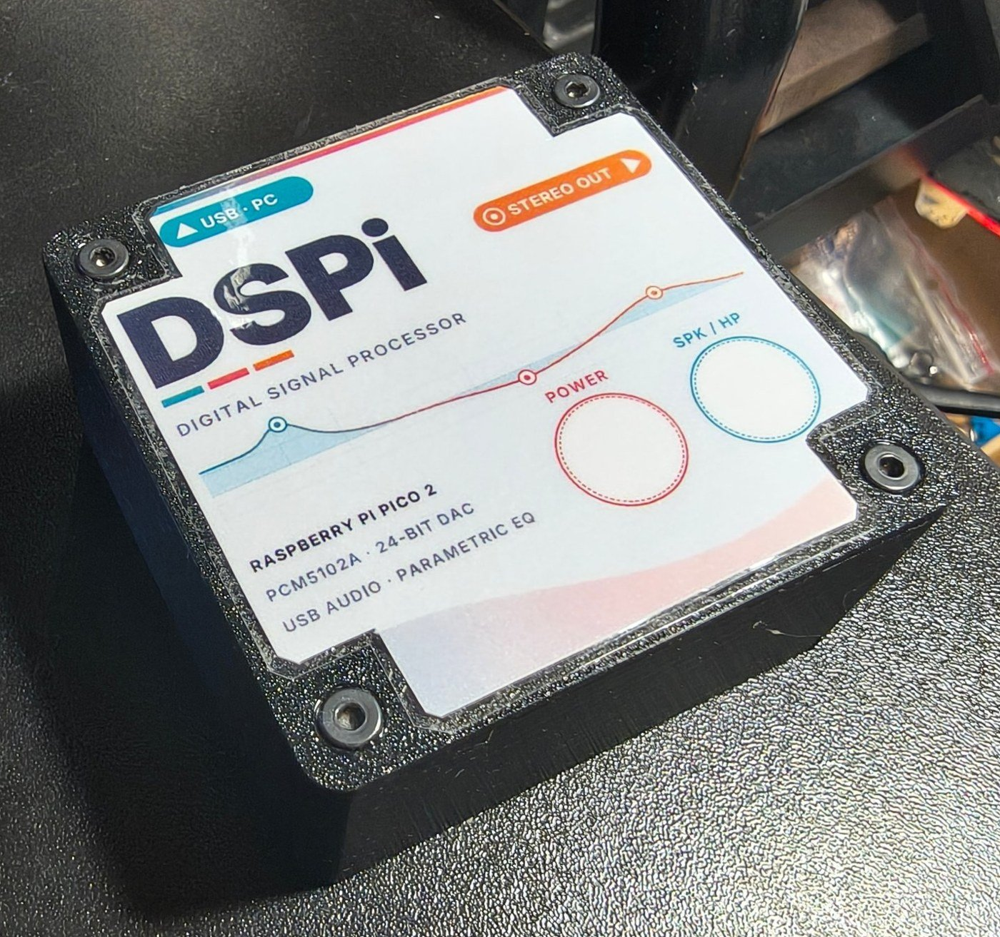
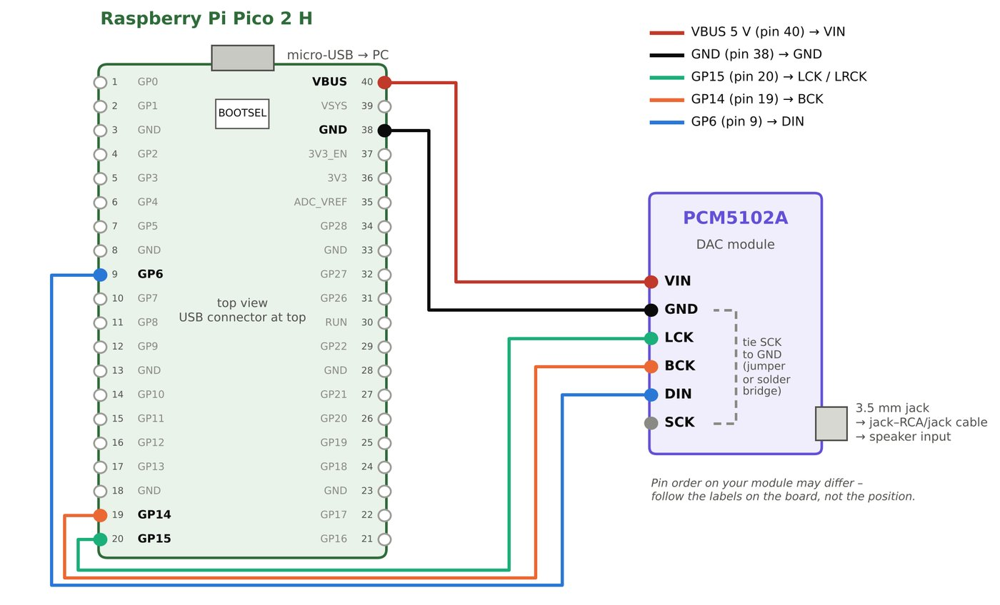
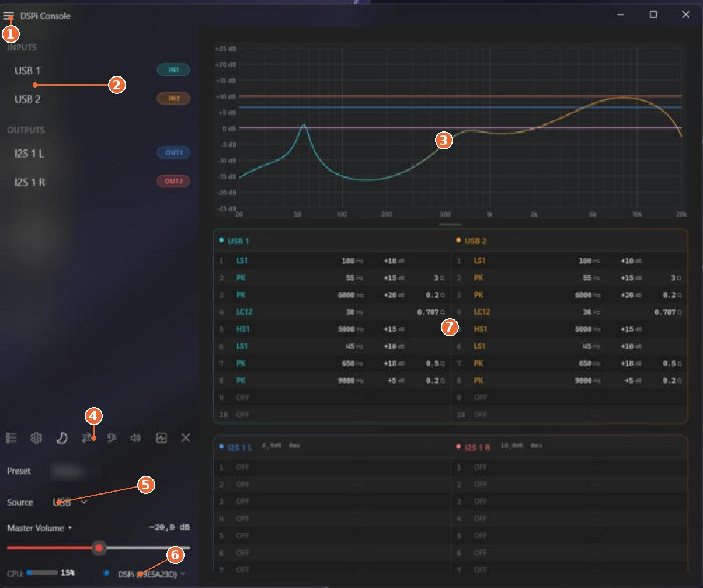
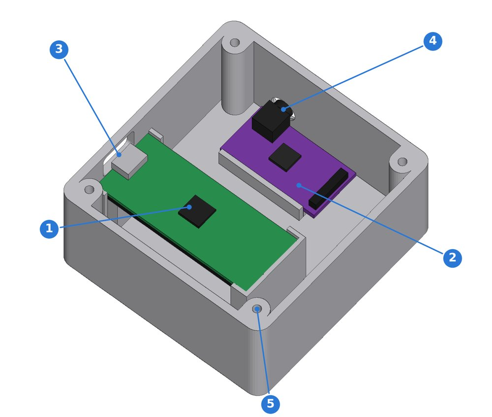
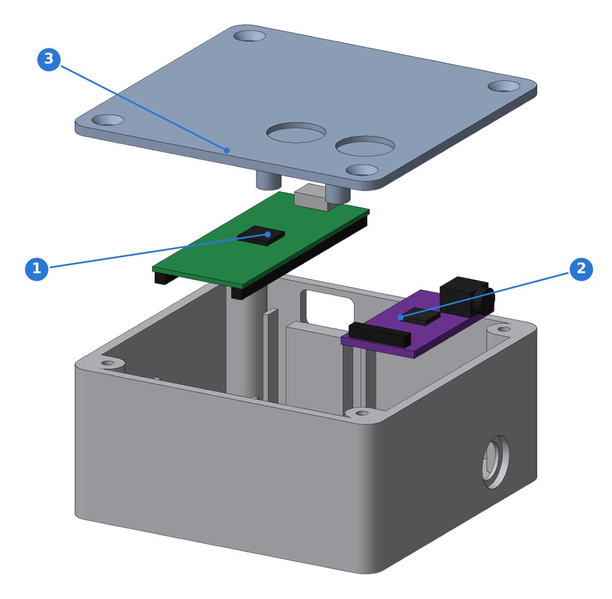
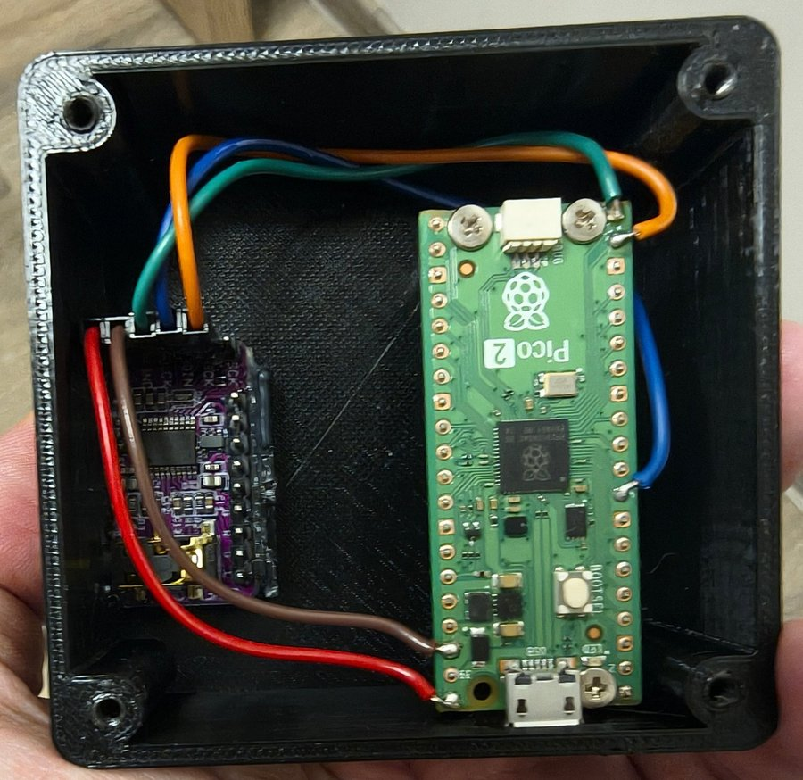
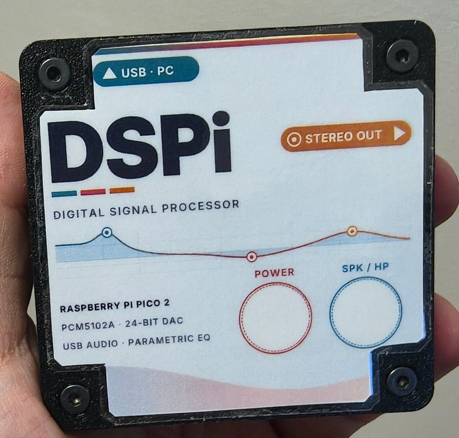

# DSPi on Raspberry Pi Pico 2 – a DIY USB DSP sound card

**English** · [Česky](#česky)

A USB sound card with a full parametric equalizer, loudness, crossovers and presets, built for about €15 from a
**Raspberry Pi Pico 2** and a **PCM5102A** DAC module, running the open-source
[**DSPi** firmware by Weeb Labs](https://github.com/WeebLabs/DSPi). Your computer sees it as an ordinary audio
device with no drivers. All the processing runs on the Pico, so the correction works the same on Windows, macOS, Linux and iOS.

This repository has everything you need to build one:

- a **step-by-step build and setup guide** (PDF, English and Czech): wiring, flashing, DSPi Console, tuning the sound, presets and a control panel
- a **3D-printed enclosure**: STL files plus a parametric Autodesk Fusion script
- **printable stickers** for the lid and the bottom (with a QR code), in English and Czech

> This is a community build guide. It is not affiliated with Weeb Labs or Raspberry Pi. For the firmware itself,
> releases and support, go to the [DSPi repository](https://github.com/WeebLabs/DSPi).

## Downloads

| | English | Česky |
|---|---|---|
| **Main guide**: introduction, wiring, firmware, DSPi Console, sound tuning, presets | [DSPi_guide_EN.pdf](docs/DSPi_guide_EN.pdf) | [DSPi_navod_CZ.pdf](docs/DSPi_navod_CZ.pdf) |
| **Enclosure**: printing and assembly | [DSPi_enclosure_EN.pdf](docs/DSPi_enclosure_EN.pdf) | [DSPi_krabicka_CZ.pdf](docs/DSPi_krabicka_CZ.pdf) |

| Files | |
|---|---|
| [`enclosure/stl/DSPi_krabicka_spodek.stl`](enclosure/stl/DSPi_krabicka_spodek.stl) | enclosure **base** |
| [`enclosure/stl/DSPi_krabicka_viko.stl`](enclosure/stl/DSPi_krabicka_viko.stl) | enclosure **lid** (flip it outer face down for printing) |
| [`enclosure/fusion/DSPi_krabicka/`](enclosure/fusion/DSPi_krabicka/) | Fusion script that generates both parts; every dimension is a parameter at the top of the file |
| **DSPi_lid_sticker_light** · [EN](sticker/DSPi_lid_sticker_light_EN.pdf) · [CZ](sticker/DSPi_lid_sticker_light_CZ.pdf) | full-lid sticker, light version with a margin for laminating (recommended) |
| **DSPi_lid_sticker_dark** · [EN](sticker/DSPi_lid_sticker_dark_EN.pdf) · [CZ](sticker/DSPi_lid_sticker_dark_CZ.pdf) | dark version: labels and button strips |
| **DSPi_bottom_sticker_QR** · [EN](sticker/DSPi_bottom_sticker_QR_EN.pdf) · [CZ](sticker/DSPi_bottom_sticker_QR_CZ.pdf) | bottom sticker with a QR code linking to this repository (corner notches for rubber feet), plus small QR-only labels |
| [`sticker/source/`](sticker/source/) | Python/reportlab sources of the stickers; run e.g. `python3 sticker_light.py en out.pdf` (needs the [Inter](https://rsms.me/inter/) font, OFL, in `fonts/` next to the script) |

## Hardware

| Part | Approx. price |
|---|---|
| Raspberry Pi Pico 2 H (RP2350, pre-soldered headers) | €7 |
| PCM5102A DAC module, e.g. GY-PCM5102 (≈ 32 × 17 mm, jack on the long edge) | €4–6 |
| 5 female–female jumper wires, micro-USB data cable, 3.5 mm audio cable | €5 |
| Enclosure: ≈ 50 g PLA/PETG, 4× M3 × 10–12 countersunk screws, a little hot glue or silicone | €1–2 |

| Wire | Pico 2 | PCM5102A |
|---|---|---|
| power | pin 40 – VBUS (5 V) | VIN |
| ground | pin 38 – GND | GND |
| bit clock | pin 19 – GP14 | BCK |
| LR clock | pin 20 – GP15 | LCK |
| data | pin 9 – GP6 | DIN |

On the DAC module, connect SCK to GND, set FMT to L and XSMT to H. The guide covers the solder bridges in detail.

## Quick start

1. Flash `DSPi-RP2350-vX.Y.Z.uf2` from the [DSPi releases](https://github.com/WeebLabs/DSPi/releases): hold BOOTSEL, plug in USB, then drag the file onto the drive that appears.
2. Install [DSPi Console](https://github.com/WeebLabs/DSPi-Console-Windows/releases). **Its version must match the firmware.**
3. In **Settings → Hardware → Mains Outputs**, switch OUT 1/2 from S/PDIF to **I²S**, then **☰ → Save Output Config**.
4. Choose *Weeb Labs DSPi* as the system audio output, then tune the EQ and save a preset (**☰ → Save Preset**).

## Enclosure

 

- Outer size 70.8 × 68.8 × 34 mm. Micro-USB exits at the back and the 3.5 mm jack on the right side.
- The Pico sits in a printed cradle whose supports are between the pin rows. The DAC rests on supports at the right wall. Both are **glued**, so no M2 screws are needed.
- Four M3 screws hold the lid. It also has two recesses (0.8 mm skin) that you can drill out later for 12 × 12 mm tactile switches, for example mute and preset buttons.
- Print without supports at 0.2 mm layers with 3–4 perimeters and 20 % infill.

 

*Prototype photos. In that version the Pico was still screwed down with M2 screws; the current v3 uses the glue cradle.*

## License

- Guides, enclosure, sticker and images: [CC BY-SA 4.0](LICENSE). You may share and adapt them, including commercially, with attribution and under the same license.
- The **DSPi firmware and DSPi Console** are © Weeb Labs and licensed under GPL-3.0. They are not included here; get them from the [original project](https://github.com/WeebLabs).
- Screenshots of DSPi Console are included for documentation purposes.

---

## Česky

Zvuková karta na USB s parametrickým ekvalizérem, loudness, výhybkami a presety za zhruba 300 Kč. Postavíte ji
z **Raspberry Pi Pico 2** a modulu **PCM5102A** s open-source firmwarem [**DSPi** (Weeb Labs)](https://github.com/WeebLabs/DSPi).
Počítač ji vidí jako běžné zvukové zařízení bez ovladačů a všechny korekce běží přímo v Picu.

V repozitáři najdete:

- **návod** na zapojení, nahrání firmwaru, nastavení v DSPi Console, ladění zvuku, presety a ovládací panel: [DSPi_navod_CZ.pdf](docs/DSPi_navod_CZ.pdf)
- **3D tištěnou krabičku** (STL a skript pro Fusion) s návodem na tisk a sestavení: [DSPi_krabicka_CZ.pdf](docs/DSPi_krabicka_CZ.pdf)
- **samolepku na víko** k vytištění: [světlá](sticker/DSPi_lid_sticker_light_CZ.pdf) (doporučená, s okrajem pro laminaci) a [tmavá](sticker/DSPi_lid_sticker_dark_CZ.pdf), na dno krabičky [samolepka s QR kódem](sticker/DSPi_bottom_sticker_QR_CZ.pdf) odkazujícím sem

Názvy STL: `spodek` je spodní díl, `viko` je víko (při tisku ho otočte vnější plochou dolů).
Pico i modul DAC se v krabičce vkládají do lůžek a lepí, šroubky M2 nepotřebujete.

Licence: návody, krabička a samolepka jsou pod CC BY-SA 4.0. Firmware DSPi a DSPi Console jsou dílo Weeb Labs pod licencí GPL-3.0.
